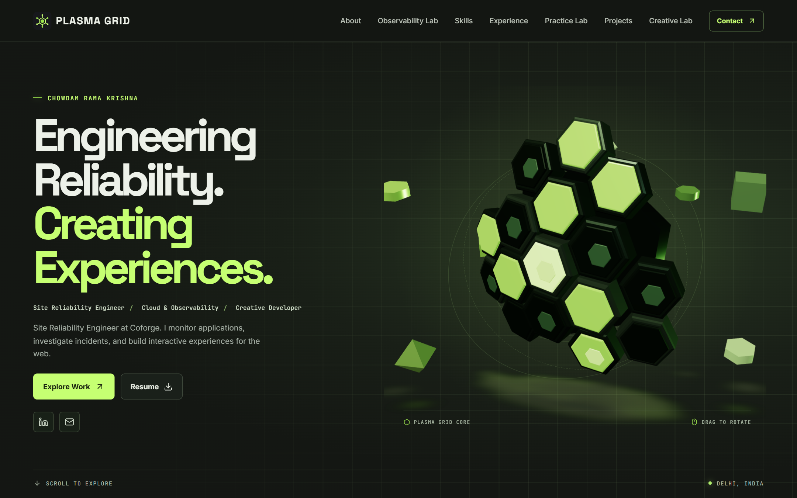

# PLASMA GRID

### Interactive 3D SRE & Creative Developer Portfolio

[🌐 View Live Website](https://plasma-grid.pages.dev/)

PLASMA GRID is Chowdam Rama Krishna’s portfolio for site reliability engineering and creative development. It brings together professional experience, hands-on incident simulations, and interactive 3D work in a single website.

## Explore the portfolio

| Feature | What you can do |
| --- | --- |
| **Interactive 3D Hero** | Drag the rotating WebGL core to inspect it from different angles. |
| **Observability Lab** | Explore synthetic service telemetry, change time ranges and services, and compare healthy operations, database slowdown, and service outage. |
| **Quantum Fracture** | Scroll through a five-stage 3D sequence that breaks apart a faceted sculpture and reassembles it when you scroll back. |
| **Practice Lab** | Investigate a simulated incident using metrics and logs, identify the cause, and apply a recovery action. |
| **Professional Experience and Certifications** | Review Chowdam’s roles at Coforge, education, and credentials in observability, cloud, and AI. |
| **Featured Projects** | Browse project pages for the Classroom Management System and the ALPHABET WAR game prototype. |
| **Creative Lab** | Browse a filterable gallery with placeholders for digital art, character studies, game concepts, and experiments. |

The labs use simulated data and keep independent sessions. The site supports reduced motion and provides static artwork where WebGL is unavailable.

## Technology stack

| Area | Tools |
| --- | --- |
| Application | React 19, TypeScript, Vite, React Router |
| 3D and motion | Three.js, React Three Fiber, Drei, Motion |
| Charts and interface | Recharts, Tailwind CSS, Lucide React |
| Browser testing | Playwright with Chromium |
| Hosting | Cloudflare Pages with Git integration |

## Run locally

Requires Node.js 22.12 or newer.

~~~sh
npm ci
npm run dev
~~~

Use `npm run check` for TypeScript checks, `npm run build` to generate `dist/`, and `npm run preview` to serve that build locally.

~~~sh
npx playwright install chromium
npm run build
npm test
~~~

The browser tests run against the production preview. Set `PLASMA_GRID_BROWSER_PATH` to an installed Chromium executable if needed.

## Project structure

- [src/content/](src/content/) holds the profile, experience, certifications, skills, project details, artwork, and synthetic telemetry model.
- [src/Scene.tsx](src/Scene.tsx) and [src/WarpScene.tsx](src/WarpScene.tsx) render the 3D scenes.
- [public/](public/) contains the downloadable résumé and static assets.
- [tests/](tests/) covers navigation, URL cleanup, observability, and interactive behavior.

## Deployment

Cloudflare Pages builds this repository automatically on pushes to `main`. It runs `npm run build` from the repository root and publishes `dist/`. The portfolio uses hash-based routes and requires no application environment variables.
